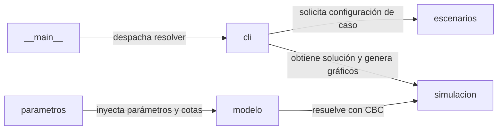

[Leer en español](README.md)

# Optimización de presupuesto para e-commerce

Mixed-integer programming (MIP) model for cost and team allocation in Colombian e-commerce development projects under budget and timeline constraints.

[](https://github.com/ale0009/optimizacion-presupuesto-ecommerce/actions/workflows/ci.yml)


## Why this exists

Determine the optimal mix of team capacity and software stack that minimizes cost while satisfying budget, capacity, and critical path timeline constraints.

## Architecture



### Components

| Component | Responsibility |
| --- | --- |
| `parametros` | Carga y validación de tarifas salariales, factor prestacional (0.52), duraciones de fases y costos tecnológicos desde datos/parametros.yaml. |
| `modelo` | Construcción formal del problema MIP en PuLP (variables enteras de roles, binarias de tecnología, restricciones de presupuesto, QA y ruta crítica). |
| `escenarios` | Definición de casos de estudio (pequeña, mediana, grande) y ponderación de funciones objetivo (costo puro frente a penalización temporal). |
| `simulacion` | Invocación del solver CBC, verificación de optimalidad matemática y extracción estructurada de costos y asignaciones. |
| `cli` | Interfaz de línea de comandos para resolver casos, imprimir resúmenes tabulares y generar diagramas de Gantt y costos. |
| `__main__` | Punto de entrada ejecutable del paquete para delegar la ejecución a la interfaz CLI. |

## Stack

- Python
- PuLP
- PyYAML
- Matplotlib
- pytest
- uv

## Getting Started

### Installation

```bash
uv sync --python 3.11
```

### Testing

```bash
uv run pytest -q
```

### Execution

```bash
uv run python -m optimizacion_ecommerce resolver --caso pequena
```

## Results

| Metric | Value | Note |
| --- | --- | --- |
| Caso Pequeña - Costo optimizado | 55.506.000 COP | Solución óptima (Optimal) para 3 de 4 personas en 9 semanas frente a presupuesto de 120.000.000 COP. |
| Caso Mediana - Costo optimizado | 207.792.000 COP | Solución óptima (Optimal) para 6 de 7 personas en 16 semanas frente a presupuesto de 250.000.000 COP. |
| Caso Grande - Costo optimizado | 311.088.000 COP | Solución óptima (Optimal) para 6 de 12 personas en 24 semanas frente a presupuesto de 400.000.000 COP. |

## Limitations and Roadmap

### Limitations

- Es un modelo didáctico ilustrativo que no reemplaza cotizaciones comerciales ni asesoría legal, laboral o tributaria.
- Asume asignación uniforme del equipo durante todo el calendario sin distribución dinámica por sprint ni balanceo de carga entre fases.
- No modela dependencias externas, riesgos imprevistos, rotación de colaboradores ni variaciones de alcance durante la ejecución.

### Roadmap

- Permitir la asignación dinámica de horas y perfiles por fase específica en lugar de contratación fija horizontal.
- Implementar análisis estocástico de Monte Carlo para evaluar incertidumbre en salarios y duraciones de fase.
- Añadir modelado de solapamiento de fases (técnicas de fast-tracking).

## Origin

Individual, open-source reimplementation based on an academic team project at Universidad ECCI, carried out with my teammate [**David Alexander Rincón Corredor (Kuronoma)**](https://www.linkedin.com/in/davidalexanderrinconcorredorkuronoma/) and team.

## License

This project is licensed under the terms of the MIT license. See the LICENSE file for details.

Copyright (c) 2026 Mario Alejandro Puerta Alarcón.
