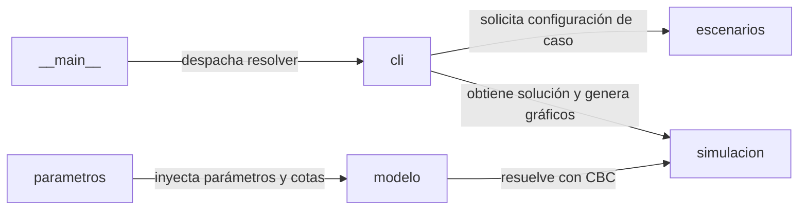

# Arquitectura del Sistema: Optimización de presupuesto para e-commerce

## Visión general

Modelo de optimización entera mixta (MIP) para asignar presupuesto, perfiles y componentes tecnológicos en proyectos de comercio electrónico en Colombia.

Determinar la combinación de equipo técnico y arquitectura tecnológica que minimice costos cumpliendo restricciones de presupuesto, capacidad y ruta crítica.

## Diagrama de arquitectura



## Componentes

| Componente | Responsabilidad |
| --- | --- |
| `parametros` | Carga y validación de tarifas salariales, factor prestacional (0.52), duraciones de fases y costos tecnológicos desde datos/parametros.yaml. |
| `modelo` | Construcción formal del problema MIP en PuLP (variables enteras de roles, binarias de tecnología, restricciones de presupuesto, QA y ruta crítica). |
| `escenarios` | Definición de casos de estudio (pequeña, mediana, grande) y ponderación de funciones objetivo (costo puro frente a penalización temporal). |
| `simulacion` | Invocación del solver CBC, verificación de optimalidad matemática y extracción estructurada de costos y asignaciones. |
| `cli` | Interfaz de línea de comandos para resolver casos, imprimir resúmenes tabulares y generar diagramas de Gantt y costos. |
| `__main__` | Punto de entrada ejecutable del paquete para delegar la ejecución a la interfaz CLI. |

## Flujo de datos

1. **__main__** comunica con **cli**: despacha resolver.
2. **cli** comunica con **escenarios**: solicita configuración de caso.
3. **parametros** comunica con **modelo**: inyecta parámetros y cotas.
4. **modelo** comunica con **simulacion**: resuelve con CBC.
5. **cli** comunica con **simulacion**: obtiene solución y genera gráficos.

## Registro de Decisiones de Arquitectura (ADR)

- [ADR-0001: Modelado mediante Programación Lineal Entera Mixta (MIP) con PuLP y CBC](adr/0001.md)
- [ADR-0002: Separación de parámetros en archivo YAML declarativo](adr/0002.md)
- [ADR-0003: Cálculo de calendario mediante ruta crítica secuencial de fases](adr/0003.md)

## Calidad y pruebas

La verificación técnica del sistema se realiza de forma automatizada mediante la ejecución de:

```bash
uv run pytest -q
```
